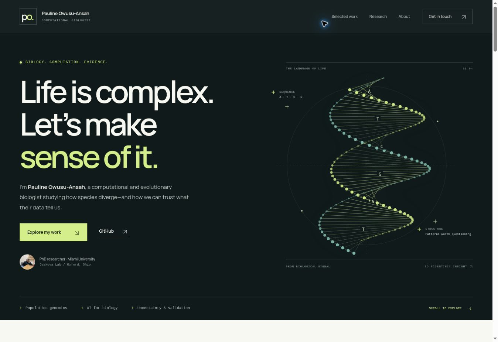

# Pauline Owusu-Ansah — Research Portfolio

A responsive computational and evolutionary biology portfolio at **https://codewithpauline.github.io/**.

The site presents Pauline as a computational biologist and PhD researcher, with selected work in genomic representations, statistical reliability, ecological modeling, and reproducible population genomics.

## Implementation

Static HTML, CSS, and progressive-enhancement JavaScript. No build, external runtime dependency, trackers, third-party fonts, or API keys are required. GitHub Pages serves the root of `main`; `.nojekyll` is preserved. The entire site, including methods disclosures, remains usable without JavaScript. JavaScript adds mobile navigation and an interactive benchmark metric switch.

- `index.html` — content, semantic structure, evidence links, SEO and social metadata.
- `styles.css` — responsive design, keyboard focus, reduced-motion and print styles.
- `script.js` — navigation, section indicators, and fixed source-verified benchmark values.
- `assets/` — local photographs, project figure, decorative helix, social preview, favicon, and licensed fonts.

To preview locally, serve this directory with any static server, for example `python -m http.server 8000`, and open the returned local address. GitHub Pages deploys automatically after a commit to its publishing branch. The site's previous version remains recoverable in Git history.

## Content provenance

Reviewed 8 November 2026 against public project documentation. Project results are development evidence, not claims of peer review or general biological validity.

- **GeneScope-FM:** `docs/benchmarks/chromosome-holdout/README.md`, content SHA `664c04b1f168c725c7dda4cae4e5d0411a921720`. Human non-TATA promoter classification; 3,000 sequences, 600 test examples, six held-out chromosomes. Balanced accuracy: 68.2%, 73.7%, 80.2%. AUROC: 0.736, 0.815, 0.859. The paired NT-versus-3-mer difference is +6.5 percentage points (95% interval +3.33 to +9.67), or +0.0439 AUROC (+0.0072 to +0.0768). Differences use the report's unrounded paired results. They must not be reconstructed from rounded displayed scores. Bars start at zero. The metric switch changes all labels, bar lengths, axis maximum, accessible description, and paired interval together. Six groups, one partition, and possible homology/pretraining overlap limit generalization.
- **snpflowR:** `validation/uncertainty/README.md`, content SHA `f50e1f84412542041e8ae00d9700ea2246959517`. The prospective internal study includes 15,125 synthetic datasets, 17 scenarios, and four resampling methods. All failed the overall calibration screen. The displayed false-support comparison is one specific scenario: 1,000 datasets, 40:40 samples, and four identical SNP copies per block; locus 33.5%, block 6.1%. It does not establish general error rates, validated migration inference, or a calibrated replacement method.
- **RangeShift AI:** README content SHA `d192edfe5d953759553edd47a8e10b6b7d61b8f6`. The public demonstration's uncertainty analysis includes 12 model fits × six climate scenarios = 72 projections. The original figure shows the habitat-suitability case study, not the 72-projection uncertainty decomposition. These are software demonstrations, not validated conservation forecasts.
- **Existing identity, education, teaching, affiliations, contact links, and photographs:** retained from the previously published portfolio. Research terminology uses “PhD researcher,” with the degree clearly in progress.

The site links to the full public reports so readers can inspect assumptions, limitations, methods, and saved evidence. The hero helix is decorative DNA-inspired vector art, not a molecular structure or a measured result.

## Asset credits

- Personal photographs: previously published `codewithPauline` profile and portfolio assets. Speaking photograph: The Story Collider, Montréal, 2024; original filename `Majolica_Photo_StoryCollider _Pauline_15.jpeg`.
- RangeShift figure: public `RangeShift-AI/docs/assets/plethodon_cinereus_case_study.png`, retained without changing its scientific content.
- Manrope: Google Fonts distribution, SIL Open Font License; see `assets/fonts/OFL.txt`.
- Helix, favicon, and social preview: site-specific vector artwork and typography.

Existing unused GeneScope synthetic demo and PopGenMapper example assets remain available at their original paths for link compatibility. Personal photos and third-party assets retain their existing rights.

## Verification

The redesign was visually reviewed in a browser at desktop, tablet, and narrow mobile widths. Checks covered the mobile menu, automatic menu closure after navigation, benchmark metric switching, methods disclosure, horizontal overflow, image loading, and the no-JavaScript navigation fallback. Static checks cover JavaScript syntax, formatting, local asset paths, internal anchors, unique IDs, JSON-LD, and SVG validity. Research values were checked against the source reports above.

